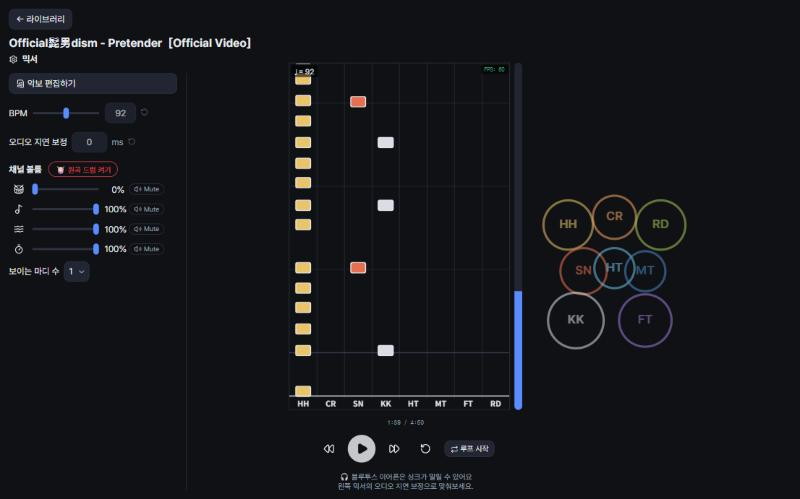
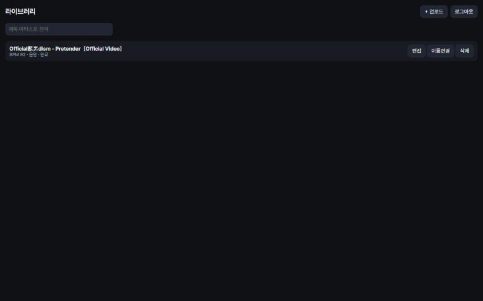

# 드럼 연습 서비스

악보를 읽기 어려운 사람이, 좋아하는 곡의 음원(또는 디지털 악보)에서 만든 드럼 MIDI를 리듬게임식 화면으로 보며 실제 드럼을 연습하는 웹앱입니다. 집에 있는 PC를 서버로 써서, 폰·태블릿·노트북 어디서든 Tailscale로 접속합니다.

## 미리보기

| 연습 화면 | 라이브러리 |
|---|---|
|  |  |

연습 화면은 음악 재생 위치에 맞춰 노트가 레인을 따라 내려오고(8레인: HH·CR·SN·KK·HT·MT·FT·RD), BPM·오디오 지연 보정·트랙별(원곡 드럼/음악/가상 드럼/메트로놈) 볼륨을 그 자리에서 조절할 수 있습니다.

## 주요 기능

- **음원 → 드럼 채보**: 업로드한 곡(mp3/wav/m4a/flac/mp4)을 Demucs로 드럼 트랙만 분리하고, AI 채보 모델로 킥·스네어·하이햇·탐·크래시·라이드 노트를 생성
- **디지털 악보 가져오기**: MIDI(.mid), MusicXML, Guitar Pro 파일도 같은 내부 형식으로 변환해 동일하게 연습 가능
- **MIDI 간단 편집기**: 노트 추가·삭제·이동(그리드 스냅), 킷 피스 변경, 셈여림 조절, 20단계 이상 실행 취소
- **연습 화면**: 배속(50~150%, 음정 유지) 재생, 메트로놈, 구간 반복(루프), 스티킹(좌/우 손) 표시·편집
- **라이브러리 & 다중 기기**: 업로드한 곡 관리, 계정 로그인으로 폰·태블릿·PC 어디서든 같은 라이브러리에 접속
- **집 PC 하나로 운영**: API 서버·작업 워커·화면까지 스크립트 하나(`start.ps1`/`start.py`)로 띄우고, Tailscale로 외부 접속 제공(공인 IP·포트포워딩 불필요)

## 기술 스택

| 영역 | 기술 |
|---|---|
| 프론트엔드 | React + TypeScript + Vite |
| 오디오 엔진 | Web Audio API, Tone.js(스케줄링·메트로놈) |
| 백엔드 | Python 3.11+ / FastAPI / Uvicorn |
| 작업 큐 | SQLite 테이블 기반 자체 워커(별도 프로세스) |
| DB | SQLite |
| 음원 분리 | Demucs (htdemucs, PyTorch) |
| 원격 접속 | Tailscale (사설망 VPN) |
| 테스트 | Vitest, Playwright, pytest |

상세 아키텍처·라이선스 표는 [`intent/03-architecture-stack.md`](intent/03-architecture-stack.md) 참고.

## 구조

```
[폰/태블릿/PC 브라우저]
  └ 연습 화면(레인+킷), 오디오 엔진, 메트로놈, 편집기, 라이브러리 UI
         │ HTTPS (Tailscale 사설망)
         ▼
[집 PC — 처리 서버]
  ├ API 서버 (FastAPI) — 인증, 라이브러리, 파일 제공
  ├ 작업 워커 — 음원 분리 / 채보 / 변환
  ├ SQLite — 메타데이터, 작업 큐
  └ 파일 저장소 — data/songs/<song_id>/...
```

## 실행 방법

이 프로젝트는 의뢰인 개인이 집 PC에서 직접 운영하는 서비스입니다. 서버를 켜고 끄는 방법은 [`docs/서버-실행-안내-Windows.md`](docs/서버-실행-안내-Windows.md), 다른 기기(폰 등)에서 원격 접속하는 방법은 [`docs/원격-접속-안내-Tailscale.md`](docs/원격-접속-안내-Tailscale.md)에 정리돼 있습니다.

## 개발 과정

기획→구현→QA(Codex 읽기 전용 검수)→승인 순서의 증거 기반 파이프라인으로 진행했습니다. 단계별 진행 상황은 [`intent/05-todo.md`](intent/05-todo.md), 아키텍처와 주요 결정 이력은 [`wiki/`](wiki/)에 정리돼 있습니다.
